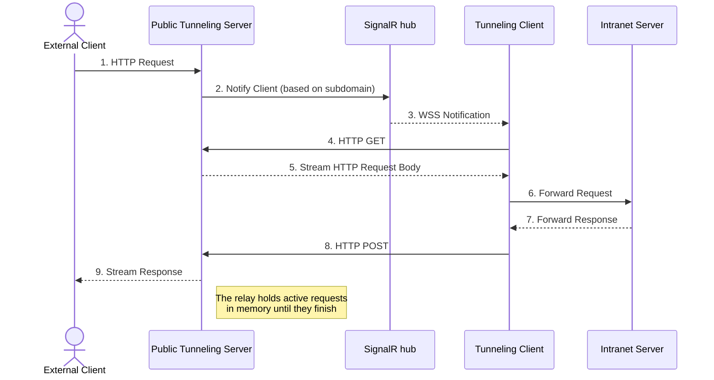
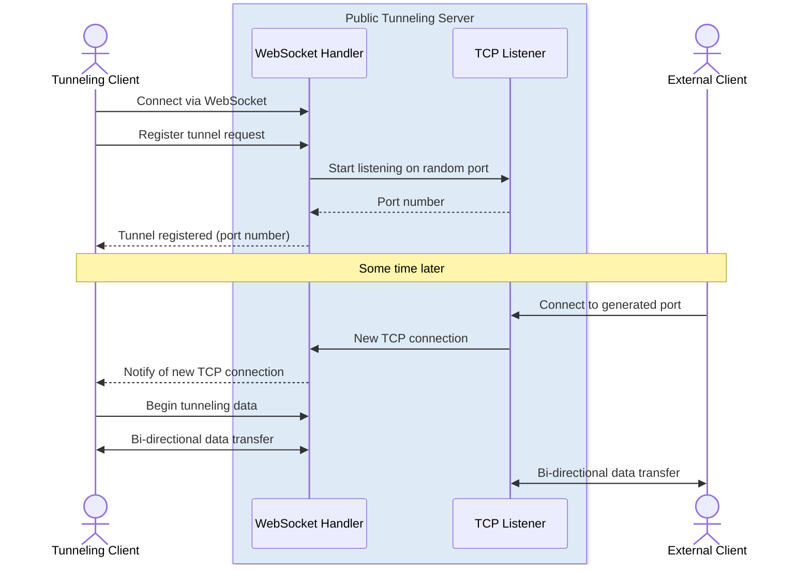
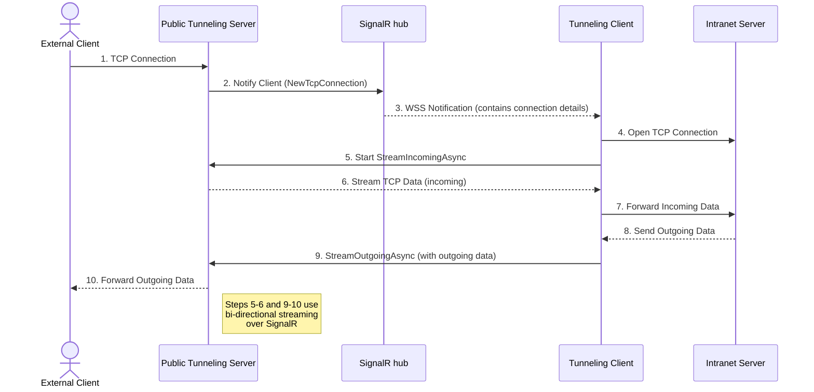

# How Tunnelite works

Tunnelite creates a bridge between your local application and the internet using a WebSocket connection. It streams incoming data from a public URL directly to your local server, making your local app accessible from anywhere.

The managed version of Tunnelite supports HTTP(S), WebSocket (WS/WSS) and Server-Sent Events tunneling. If you need TCP tunneling, you'll have to host the server yourself.

## HTTP connection

<b>TCP overview</b>

 

<b>TCP connection</b>

 

The relay keeps connection and request state in memory. Paired desktop identity and device records stay on the desktop; the relay needs no disk or database. See [relay protocol](relay-protocol.md) for registration and [security](security.md) for the trust model.
